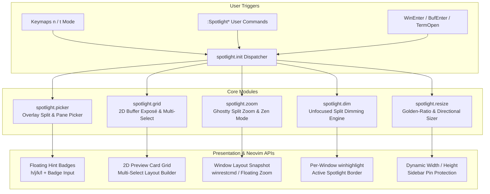

# `spotlight.nvim` — Ghostty-Inspired Visual Window, Split & Buffer Picker Specification

> **Document Type:** Plugin Design & Implementation Specification  
> **Target Environment:** Neovim `>= 0.10.0` (LuaJIT)  
> **Plugin Name:** `spotlight.nvim`  
> **Module Namespace:** `require("spotlight")`  
> **Status:** Specification Ready for Implementation  

---

## 1. Executive Summary & Vision

Working across multiple code splits, floating panels, and embedded terminal buffers in Neovim often creates visual clutter and navigation friction:
- Directional jumping (`<C-w>h/j/k/l`) requires multiple keystrokes across complex multi-split layouts.
- Standard buffer pickers show a flat 1D filename list without spatial context or multi-buffer split layout composition.
- When 3–6 splits are open simultaneously, it is hard to visually distinguish the active focused buffer from surrounding inactive panes.

**`spotlight.nvim`** brings **Ghostty terminal's split & surface ergonomics** directly inside Neovim, putting your active pane and selected buffers in the spotlight:
1. **Visual Split & Window Picker (`h/j/k/l` + Badges)**: Renders high-contrast overlay badges (`[a]`, `[s]`, `[d]`, `[f]`, ...) on every visible split and terminal window—supporting both spatial `h/j/k/l` + `<CR>` highlight movement and single-keystroke badge jumping from Normal (`n`) and Terminal (`t`) modes.
2. **Exposé Buffer Grid & Multi-Select Layout Composer**: A visual 2D card grid of open buffers (code + terminals) scoped to the active tab (with instant toggle to All Tabs), live mini-previews, `h/j/k/l` or badge selection, and `<Tab>` multi-select to tile chosen buffers into an instant side-by-side or grid split layout.
3. **Ghostty-Style Split Zoom (`toggle_split_zoom`)**: One-keystroke full-frame spotlight zoom of the current split (preserving all background splits intact) with a subtle winbar/floating badge (`🔍 ZOOM`), plus a distraction-free Zen backdrop mode.
4. **Unfocused Split Dimming (`unfocused-split-opacity`)**: Automatically dims/mutes inactive windows and terminal panes via window-scoped highlight groups (`winhighlight`) and active border accents so your eyes immediately lock onto the spotlighted buffer.
5. **Golden-Ratio Auto-Focus Resizing**: Optional dynamic split sizing that expands the active window while keeping sidebars (`neo-tree`, `trouble`, TOC drawers) locked to fixed dimensions.

---

## 2. Core Architecture & Module Flow



### Directory & Module Structure

```text
spotlight.nvim/
├── SPEC.md
├── README.md
├── plugin/
│   └── spotlight.lua                 -- Commands, autocommands, & highlight groups
├── tests/
│   ├── test_picker_spec.lua          -- Headless tests for window/split hint generation & h/j/k/l nav
│   ├── test_grid_spec.lua            -- Headless tests for tab scoping, multi-buffer selection, & tiling
│   ├── test_zoom_spec.lua            -- Headless tests for split zoom & layout restoration
│   └── test_dim_spec.lua             -- Headless tests for unfocused window dimming & exclusions
└── lua/
    └── spotlight/
        ├── init.lua                  -- Public API & setup() entry point
        ├── config.lua                -- Default options, validation, & user overrides
        ├── core/
        │   ├── picker.lua            -- Visual window/split overlay picker (h/j/k/l + Badges; Jump, Swap, Close, Pull)
        │   ├── grid.lua              -- 2D Exposé buffer preview grid & multi-buffer layout composer
        │   ├── zoom.lua              -- Ghostty-style toggle_split_zoom & Zen focus mode
        │   ├── dim.lua               -- Inactive window dimming (`winhighlight`) & active spotlight accent
        │   └── resize.lua            -- Golden-ratio auto-resizing & smart directional resize
        └── ui/
            ├── badges.lua            -- High-contrast floating hint badge & candidate border renderer
            ├── hud.lua               -- Interactive Spotlight Control Center & Layout Preset picker
            └── statusline.lua        -- Statusline / Winbar zoom & spotlight indicators
```

---

## 3. Detailed Functional Specifications

### 3.1 Visual Window & Split Picker (`spotlight.core.picker`)

Inspired by Ghostty / Tmux pane pickers, invoking the picker renders a floating badge at the geometric center (or top-right corner) of every eligible window in the current tabpage:

* **Universal Mode Support (`n` and `t` Mode)**:
  * Works seamlessly even when focused inside an active interactive terminal buffer (`term://*`, `agy`, `lazygit`, `bash`) without requiring `<Esc><Esc>` first.
  * Automatically enters Terminal Insert mode (`startinsert`) when jumping into a terminal window, or stays in Normal mode for code buffers.
* **Dual Selection Mode (`h/j/k/l` Directional Navigation + Instant Hint Badges)**:
  * **`h` / `j` / `k` / `l` (and Arrow Keys) Spatial Selection**:
    * Move a glowing highlight border / cursor spatially across splits (Left, Down, Up, Right) and press **`<CR>`** (or **`<Space>`**) to pick the highlighted window.
    * As you move with `h/j/k/l`, the candidate split's border and badge light up in real time (`SpotlightPickerCandidate`) while other splits stay dimmed.
  * **Non-Conflicting Hint Badges (`a`, `s`, `d`, `f`, `g`, `q`, `w`, `e`, `r`, `t`, ...)**:
    * `h`, `j`, `k`, and `l` are **reserved exclusively for directional movement** and excluded from the badge alphabet (`keys = "asdfgqwertzxcvbyuiopnm"`), so you can freely use `h/j/k/l` + `<CR>` OR press a single badge key (`a`, `s`, `d`, `f`) at any time without conflict.
* **Action Modes**:
  1. **Jump (`pick_window`)**: Navigate to the target split with `h/j/k/l` + `<CR>` (or press its badge key `a`/`s`/`d`/`f`) to focus that window immediately.
  2. **Swap (`swap_window`)**: Pick a target window via `h/j/k/l` + `<CR>` (or badge key) to swap its buffer and cursor position with the current window.
  3. **Close (`close_window`)**: Highlight a split with `h/j/k/l` and press `x` (or press its badge key in close mode) to close it remotely without leaving your current window.
  4. **Pull Buffer Here (`pull_from_window`)**: Pick another split via `h/j/k/l` + `p` (or badge key) and pull its buffer into the active window.
* **Smart Filtering**:
  * Ignores non-focusable floating overlays (`focusable = false`, notifications, completion popups) while optionally including focusable floating windows and sidebars.

---

### 3.2 2D Buffer Exposé Grid & Multi-Buffer Selection (`spotlight.core.grid`)

Brings a visual, spatial buffer selector ("Exposé for Neovim buffers") that goes beyond a flat fuzzy picker:

* **2D Visual Preview Cards**:
  * Displays open buffers (code files + active terminal buffers) as a responsive grid of floating cards (`2x2`, `2x3`, or `3x3` depending on terminal size).
  * Navigate across cards spatially using **`h` / `j` / `k` / `l`** + **`<CR>`**, or jump immediately using each card's non-conflicting hint badge (`[a]`, `[s]`, `[d]`, `[f]`, ...).
  * Each card displays:
    * **Hint Key Badge**: `[a]`, `[s]`, `[d]`, `[f]`, ...
    * **Header**: Filetype icon, filename, modified indicator (`●`), terminal status (`⚡ running`), and relative path.
    * **Live Snippet Preview**: 6–10 lines of syntax-highlighted content centered around the buffer's last cursor position (or latest terminal output lines for `term://*` buffers).
* **Multi-Buffer Selection & Instant Split Composition**:
  * Navigate with `h/j/k/l` and press `<Tab>` / `<Space>` (or press `<Tab>` + hint key) to **select multiple buffers** (`[✓ 1]`, `[✓ 2]`, `[✓ 3]`).
  * Press `<CR>` to open all selected buffers simultaneously in an automatic layout:
    * **2 Buffers Selected** → Side-by-side vertical split (`vsplit`) or top-bottom (`split`).
    * **3 Buffers Selected** → Primary left pane (60%) + 2 stacked right panes (40%).
    * **4+ Buffers Selected** → Balanced 2x2 tiled grid layout.
  * Press layout hotkeys inside the grid (`v` = vertical columns, `s` = horizontal rows, `g` = tiled grid, `m` = main + stack, `x` = close selected buffers) to apply batch actions to your selection.
* **Tab Workspace Scoping & `buffer-buddy` Integration**:
  * **Default (`scope = "tab"`)**: When multiple tabs are present, the Exposé Grid defaults to showing only buffers belonging to the **currently selected tab**:
    * Automatically integrates with `buffer-buddy.nvim` (`require("buffer_buddy.core.tabs").get_tab_buffers(0)`) when installed, or filters by `buflisted` + current tabpage windows (`nvim_tabpage_list_wins(0)`).
  * **Interactive Tab Bar & Global Toggle inside the Grid**:
    * Displays a workspace tab header at the top of the grid when multiple tabs exist:
      `Tabs: [ 1: Backend API * ]  [ 2: Frontend ]  [ 🌐 All Tabs (T) ]`
    * Press **`T`** inside the grid to toggle between **Current Tab Only** (`scope = "tab"`) and **All Tabs** (`scope = "all"`).
    * Press **`[` / `]`** (or `1`–`9`) inside the grid to inspect buffers in another tab without leaving the picker.
  * **Cross-Tab Selection Behavior**:
    * When viewing `All Tabs`, each card shows a tab badge (`[Tab 2]`).
    * Pressing `<CR>` or the hint key `[a-z]` on a buffer from another tab jumps directly to that tab & window (`cross_tab_action = "jump_tab"`), while pressing `<S-key>` (uppercase hint) pulls/shares that buffer into the **current tab's** split layout!
* **Quick Filter Mode**:
  * Press `/` inside the grid to live-filter buffer cards by filename or filetype (`term`, `lua`, `md`), while keeping single-key hint badges active on the remaining cards.

---

### 3.3 Ghostty-Style Split Zoom & Zen Mode (`spotlight.core.zoom`)

Modeled after Ghostty's `toggle_split_zoom`:

* **Lossless Split Zoom (`toggle_zoom`)**:
  * Maximizes the active window to fill the editor workspace while keeping all other splits alive in the background.
  * Implementation Modes (configurable):
    * **`"native"` (`winrestcmd` Split Maximize)**: Saves exact split dimensions via `vim.fn.winrestcmd()`, sets `winwidth`/`winheight` to maximum, and restores the exact cell proportions on unzoom.
    * **`"float"` (Overlay Spotlight Zoom)**: Opens the current buffer in a rounded 94%–100% floating spotlight window over the existing split layout so background terminal outputs remain subtly visible around the edges.
* **Smart Auto-Unzoom Behavior**:
  * If the user navigates to another window (`<C-w>h/j/k/l` or `:SpotlightPick`) while zoomed, `spotlight.nvim` can either:
    * Auto-restore the split layout and focus the new window (`auto_unzoom_on_leave = true`, default), OR
    * Keep zoom active and swap the zoomed spotlight view to the newly selected split (`zoom_follow_focus = true`).
* **Visual Zoom Indicator**:
  * Displays a subtle top-right virtual badge or winbar indicator: `🔦 SPOTLIGHT ZOOM [1/4 Splits]` so you never forget hidden splits are open.

---

### 3.4 Unfocused Split Dimming & Active Highlight (`spotlight.core.dim`)

Mirrors Ghostty's `unfocused-split-opacity` inside Neovim:

* **Inactive Pane Dimming**:
  * Automatically applies window-local `winhighlight` to unfocused splits on `WinLeave` / `WinEnter`:
    * Dims background/foreground contrast (`NormalNC`, `LineNr`, `SignColumn`, `EndOfBuffer`).
    * Optionally mutes diagnostic virtual text in unfocused windows to eliminate visual noise.
* **Active Spotlight Accent**:
  * Highlights the active window's winbar / statusline / border with the theme's accent color.
* **Configurable Exclusions**:
  * Exclude specific filetypes or buffer types from dimming (e.g., keep a live test runner terminal or `SuperMarkdown` preview at full brightness while editing code).

---

### 3.5 Smart Golden-Ratio Resizing (`spotlight.core.resize`)

* **Opt-In Auto-Resize (`golden_ratio`)**:
  * When enabled, automatically gives the spotlighted split ~62% width/height while shrinking unfocused splits proportionally.
  * **Sidebar & Fixed-Window Protection**: Automatically respects `winfixwidth` / `winfixheight` and ignores sidebars (`neo-tree`, `NvimTree`, `trouble`, `qf`, `SuperMarkdown` TOC sidebar).
* **Ghostty-Style Directional Resize Helpers**:
  * Smooth step resizing (`resize_split("left"|"right"|"up"|"down", step)`) that dynamically flips direction depending on split position in the layout tree.

---

## 4. UI & Interactive Wireframes

### 4.1 Visual Split Picker Overlay (`:SpotlightPick`)

```text
╭──────────────────── lua/spotlight/init.lua ────────────────────╦════════════════════ term://agy ════════════════════╗
│  1 local M = {}                                                ║                                                    ║
│  2                                                             ║  > Fix markdownlint error                          ║
│  3 function M.setup(opts)                                      ║  ● Fixed! Updated lua/plugins/markdown.lua         ║
│  4   ╭───────────╮                                             ║               ╔═══════════╗                        ║
│  5   │    [a]    │                                             ║               ║ ▶  [s]  ◀ ║ <-- Highlighted via    ║
│  6   │  init.lua │                                             ║               ║ term: agy ║     h/j/k/l movement   ║
│  7   ╰───────────╯                                             ║               ╚═══════════╝                        ║
│  8 end                                                         ╠════════════════════ term://bash ═══════════════════╣
│  9                                                             │  $ git status                                      │
│ 10 return M                                                    │                ╭───────────╮                       │
│                                                                │                │    [d]    │                       │
│                                                                │                │ term:bash │                       │
╰────────────────────────────────────────────────────────────────┴────────────────┴───────────┴───────────────────────╯
  [h/j/k/l] Move Highlight + [<CR>] Pick   [a/s/d/f...] Instant Pick   [S] Swap   [x] Close Split   [Esc] Cancel
```

### 4.2 2D Buffer Exposé & Multi-Select Layout Composer (`:SpotlightBuffers`)

```text
╭───────────────────────── 🔦 Spotlight Buffer Exposé & Layout Composer (3 Selected) ─────────────────────────╮
│ Tabs: [ 1: Spotlight Plugin * ]  [ 2: SuperMarkdown ]  [ 🌐 All Tabs (T) ]   Filter: All (6)                │
│ Selected: [1: init.lua] → [2: picker.lua] → [3: term:agy]                                                   │
├──────────────────────────────────────────┬──────────────────────────────────────────┬───────────────────────┤
│ ╔═ [a] 󰢱 lua/spotlight/init.lua ● ═ [✓ 1] ╗ │ ╭─ [s] 󰢱 lua/spotlight/picker.lua [✓ 2] ╮ │ ╭─ [d]  term://agy [✓ 3] ╮ │
│ ║ 1  local M = {}                         ║ │ │ 12 function M.pick_window(opts)       │ │ │ > Ready for spec    │ │
│ ║ 2  local cfg = require("spotlight.cfg") ║ │ │ 13   local wins = get_valid_wins()    │ │ │   spotlight.nvim    │ │
│ ║ 3  function M.setup(opts)               ║ │ │ 14   render_badges(wins)              │ │ │                     │ │
│ ║ 4    cfg.setup(opts)                    ║ │ │ 15 end                                │ │ │                     │ │
│ ╚═════════════════════════════════════════╝ │ ╰───────────────────────────────────────╯ │ ╰─────────────────────╯ │
│ ╭─ [f] 󰍔 SPEC.md ─────────────────────────╮ │ ╭─ [g] 󰢱 lua/spotlight/zoom.lua ────────╮ │ ╭─ [w]  term://bash ───╮ │
│ │ 1  # spotlight.nvim Specification       │ │ │ 1  local M = {}                       │ │ │ $ nvim --version    │ │
│ │ 2  Ghostty-inspired buffer & split...   │ │ │ 2  function M.toggle_zoom()           │ │ │ NVIM v0.11.0        │ │
│ ╰─────────────────────────────────────────╯ │ ╰───────────────────────────────────────╯ │ ╰─────────────────────╯ │
├─────────────────────────────────────────────────────────────────────────────────────────────────────────────┤
│ [h/j/k/l] Navigate Cards + [<CR>] Open   [<Tab>/<Space>] Select Card   [a/s/d/f...] Instant Jump            │
│ [T] Toggle Tab/All Scope   [[/]] Switch Tab   Layout: [v] VSplit  [s] HSplit  [g] 2x2 Grid  [m] Main+Stack  │
╰─────────────────────────────────────────────────────────────────────────────────────────────────────────────╯
```

---

## 5. Default Keybindings & User Commands

`spotlight.nvim` is designed to coexist cleanly with LazyVim, `buffer-buddy.nvim` (`<leader>B`), and `terminal-enhancement.nvim` (`<leader>t`).

### 5.1 Default Keybindings

| Keybinding | Mode | API Call | Description |
| :--- | :---: | :--- | :--- |
| **`<leader>wf`** / **`<A-w>`** | `n`, `t` | `spotlight.pick_window()` | **Visual Split Picker**: Overlay badges + `h/j/k/l` selection on splits in active tab |
| **`<leader>wb`** / **`<A-b>`** | `n`, `t` | `spotlight.open_grid({ scope = "tab" })` | **Buffer Exposé (Current Tab)**: 2D preview grid scoped to the active tab workspace |
| **`<leader>wB`** | `n`, `t` | `spotlight.open_grid({ scope = "all" })` | **Buffer Exposé (All Tabs)**: 2D preview grid across all tabs with `[Tab N]` badges |
| **`<leader>wz`** / **`<C-w>z`** | `n`, `t` | `spotlight.toggle_zoom()` | **Ghostty Split Zoom**: Maximize/restore active split (`toggle_split_zoom`) |
| **`<leader>ws`** | `n` | `spotlight.swap_window()` | **Visual Swap**: Pick a target split by `h/j/k/l` or badge to swap with current window |
| **`<leader>wx`** | `n` | `spotlight.close_window()` | **Visual Close**: Pick a target split by `h/j/k/l` or badge to close remotely |
| **`<leader>wp`** | `n` | `spotlight.pull_buffer()` | **Visual Pull**: Pick another split and pull its buffer into current window |
| **`<leader>wd`** | `n` | `spotlight.toggle_dim()` | **Toggle Dimming**: Toggle unfocused window dimming on/off (`unfocused-split-opacity`) |
| **`<leader>wg`** | `n` | `spotlight.toggle_golden()` | **Toggle Golden Ratio**: Toggle automatic golden-ratio split sizing |
| **`<leader>w=`** | `n` | `spotlight.equalize()` | **Equalize Splits**: Balance all non-fixed splits while preserving sidebar widths |
| **`<leader>wM`** | `n` | `spotlight.open_hud()` | **Spotlight HUD**: Open interactive Spotlight & Layout Preset Manager |

### 5.2 User Commands

| Command | Arguments | Description |
| :--- | :--- | :--- |
| **`:SpotlightPick`** | `[jump\|swap\|close\|pull]` | Trigger visual overlay badge + `h/j/k/l` picker on all visible splits |
| **`:SpotlightBuffers`** | `[tab\|all\|code\|term]` | Open the 2D Buffer Exposé preview grid & multi-select layout composer |
| **`:SpotlightZoom`** | `[float\|native]` | Toggle Ghostty-style split zoom on the active window |
| **`:SpotlightLayout`** | `<vsplit\|hsplit\|grid\|main_left\|main_top>` | Arrange currently visible or selected buffers into a preset split layout |
| **`:SpotlightDim`** | `[on\|off\|toggle]` | Control unfocused split dimming |
| **`:SpotlightGolden`** | `[on\|off\|toggle]` | Control automatic golden-ratio split resizing |
| **`:SpotlightHUD`** | *none* | Open the interactive Spotlight Control Center |

---

## 6. Configuration Schema (`lua/spotlight/config.lua`)

```lua
require("spotlight").setup({
  -- 1. Visual Split & Window Picker (Overlay Badges + h/j/k/l Navigation)
  picker = {
    directional_keys = true,             -- Use h/j/k/l (and arrows) to move highlight across splits + <CR> to pick
    keys = "asdfgqwertzxcvbyuiopnm",     -- Hint labels (excludes h/j/k/l so both work simultaneously!)
    position = "center",                 -- "center" | "top_right" | "top_left"
    badge_size = "large",                -- "compact" (1-line) | "large" (3-line box with buffer name)
    include_floating = false,            -- Include focusable floating windows
    include_sidebars = true,             -- Allow picking Neo-tree / Trouble / TOC sidebars
    auto_terminal_insert = true,         -- Automatically enter insert mode when jumping to a terminal split
  },

  -- 2. 2D Buffer Exposé Grid & Multi-Select Layout Composer
  grid = {
    default_scope = "tab",               -- "tab" (current tab workspace only) | "all" (all tabs)
    cross_tab_action = "jump_tab",       -- "jump_tab" (switch to that tab) | "pull" (open in current tab)
    max_columns = 3,                     -- Max cards per row in the Exposé grid
    preview_lines = 8,                   -- Lines of syntax-highlighted preview per card
    include_terminals = true,            -- Show running terminal buffers in the grid
    default_multi_layout = "auto",       -- "auto" | "vsplit" | "hsplit" | "grid" | "main_left"
    border = "rounded",
  },

  -- 3. Ghostty-Style Split Zoom
  zoom = {
    mode = "native",                     -- "native" (winrestcmd maximize) | "float" (fullscreen spotlight overlay)
    float_scale = 0.94,                  -- Scale when mode == "float"
    show_badge = true,                   -- Show "🔦 SPOTLIGHT ZOOM [1/N]" indicator badge
    auto_unzoom_on_leave = true,         -- Restore splits automatically when switching windows
  },

  -- 4. Unfocused Split Dimming (Ghostty `unfocused-split-opacity`)
  dim = {
    enabled = true,
    dim_terminal = false,                -- Keep live terminal buffers bright or dim them too
    mute_diagnostics = true,             -- Hide diagnostic virtual text in unfocused splits
    excluded_filetypes = {
      "neo-tree",
      "Trouble",
      "qf",
      "snacks_notif",
      "lazy",
      "mason",
    },
  },

  -- 5. Smart Golden-Ratio Auto-Resizing
  resize = {
    golden_ratio = false,                -- Opt-in automatic golden-ratio split sizing on WinEnter
    focused_width_ratio = 0.62,          -- Target width % for focused window
    focused_height_ratio = 0.62,         -- Target height % for focused window
    step_size = 5,                       -- Step size for directional resize helpers
  },
})
```

---

## 7. Public Lua API (`require("spotlight")`)

```lua
local spotlight = require("spotlight")

-- Visual Window & Split Picker
spotlight.pick_window({ action = "jump" })    -- "jump" | "swap" | "close" | "pull"
spotlight.swap_window()
spotlight.close_window()
spotlight.pull_buffer()

-- 2D Buffer Exposé Grid & Multi-Buffer Composer
spotlight.open_grid({ scope = "tab" })        -- "tab" | "all" | "code" | "term"
spotlight.compose_layout(bufnrs, "main_left") -- Arrange a list of buffers into a target split layout

-- Ghostty Split Zoom
spotlight.toggle_zoom()

-- Dimming & Resizing
spotlight.toggle_dim()
spotlight.toggle_golden()
spotlight.equalize()
```

---

## 8. Implementation & Verification Plan

1. **Phase 1 — Core Window Picker (`lua/spotlight/core/picker.lua` & `lua/spotlight/ui/badges.lua`)**:
   - Enumerate tabpage windows, compute screen coordinates (`nvim_win_get_position`, `nvim_win_get_width/height`), open high-contrast floating badge windows, and support both `h/j/k/l` spatial highlight movement + `<CR>` and direct badge key (`a/s/d/f...`) input.
   - Support Jump, Swap, Close, and Pull actions from both Normal and Terminal modes.
2. **Phase 2 — 2D Buffer Exposé Grid & Multi-Select Tiler (`lua/spotlight/core/grid.lua`)**:
   - Build the floating card grid displaying buffer metadata + syntax-highlighted preview snippets, scoped to the current tab (`buffer-buddy` aware) with `T` toggle for All Tabs.
   - Implement `h/j/k/l` card navigation, `<Tab>` multi-select ordering, and the layout engine (`vsplit`, `hsplit`, `2x2 grid`, `main + stack`).
3. **Phase 3 — Split Zoom & Unfocused Dimming (`lua/spotlight/core/zoom.lua` & `lua/spotlight/core/dim.lua`)**:
   - Implement lossless `winrestcmd()` / floating zoom state machine with `🔦 SPOTLIGHT ZOOM` badge and `WinEnter`/`WinLeave` `winhighlight` dimming.
4. **Phase 4 — Headless Test Suite (`tests/*_spec.lua`)**:
   - Automated headless Neovim tests verifying multi-split badge assignment, `h/j/k/l` directional geometry, tab-scoped buffer filtering, multi-buffer layout composition (`2`, `3`, `4` buffers), and zoom restoration.
